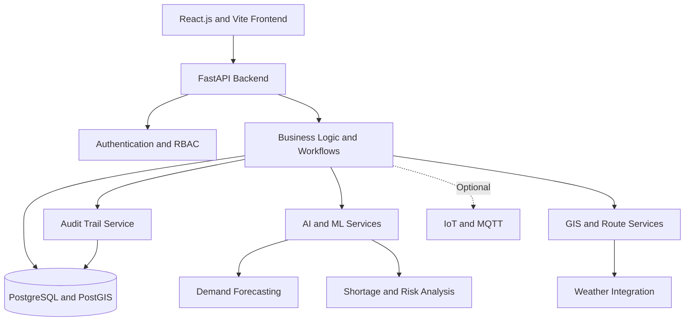

# ABHEDYA — Predictive Logistics Decision System

ABHEDYA is a predictive logistics decision-support platform designed to improve logistics planning for geographically dispersed and operationally challenging forward formations. It integrates demand forecasting, inventory management, procurement, GIS-based route planning, shipment tracking, and accountable decision-making into one connected platform.

> **Note:** This project is a prototype. Demonstration data may be simulated and should not be treated as real operational data.

## Table of Contents

- [Problem Statement](#problem-statement)
- [Solution Overview](#solution-overview)
- [Key Features](#key-features)
- [User Roles](#user-roles)
- [Technology Stack](#technology-stack)
- [System Architecture](#system-architecture)
- [Workflow](#workflow)
- [Project Structure](#project-structure)
- [AI and Machine Learning](#ai-and-machine-learning)
- [Security and Governance](#security-and-governance)
- [Future Scope](#future-scope)

## Problem Statement

Logistics operations often depend on disconnected data sources for demand, inventory, suppliers, transportation, weather, and consumption. This makes it difficult to anticipate shortages, identify bottlenecks, evaluate delivery feasibility, and prioritize limited resources.

ABHEDYA aims to solve these challenges by connecting logistics information and providing predictive, explainable, and coordinated decision support.

## Solution Overview

ABHEDYA represents logistics as a connected network of depots, supply routes, destinations, shipments, suppliers, and inventory.

The platform connects six stages of the supply lifecycle:

1. **Demand:** Forecast future supply requirements.
2. **Procurement:** Identify appropriate sourcing options.
3. **Inventory:** Track usable, reserved, damaged, and expired stock.
4. **Distribution:** Evaluate transportation routes and delivery risks.
5. **Receiving:** Verify delivered quantities and product condition.
6. **Consumption:** Use actual consumption data to improve future forecasts.

## Key Features

### 1. AI-Based Demand Forecasting
- Predict future consumption and stock requirements.
- Identify potential shortages before they occur.
- Compare projected inventory against safety thresholds.
- Simulate high-demand and delayed-supply scenarios.
- Provide explanations for generated shortage alerts.

### 2. GIS-Based Logistics Planning
- Display depots, destinations, and supply routes on an interactive map.
- Compare route distances and estimated travel times.
- Evaluate weather-related delivery risks.
- Identify routes that violate configured transportation constraints.

### 3. Inventory Management
- Maintain inventory records across locations.
- Track usable, reserved, damaged, and expired stock.
- Record stock receipts, issues, and adjustments.
- Update stock status and related forecasts after inventory changes.

### 4. Procurement and Approval Management
- Create replenishment proposals based on predicted shortages.
- Record supplier options and expected delivery dates.
- Support approval and rejection workflows.
- Enforce separation of duties so users cannot approve their own requests.

### 5. Shipment Tracking
- Track shipment status and assigned routes.
- Display estimated delivery windows.
- Monitor illustrative route-risk scenarios.
- Reconcile planned quantities with actual deliveries.

### 6. Network-Aware Risk Analysis
- Identify potential supply-chain bottlenecks.
- Analyze dependencies between depots and routes.
- Trace possible disruption impacts across the network.
- Prioritize locations according to configurable risk criteria.
- Support supply resilience and last-safe-resupply calculations when implemented and validated.

### 7. Governance and Audit Trails
- Provide role-based access control.
- Record who performed an action and when it occurred.
- Capture reasons for important decisions.
- Maintain traceable procurement, approval, and inventory records.

## User Roles

The system supports seven specialized roles:

| Role | Responsibilities |
|---|---|
| Inventory Manager | Maintain inventory and record stock movements |
| Demand and Supply Planner | Review forecasts and create replenishment proposals |
| Procurement and Supplier Manager | Evaluate suppliers and record sourcing decisions |
| Transportation and Distribution Manager | Review routes, delivery risks, and shipments |
| Receiving and Consumption Manager | Verify deliveries and record consumption |
| Supply Chain Controller | Review and approve or reject proposals |
| System Administrator | Manage permissions and data integrity |

## Technology Stack

The following is the recommended technology stack. Update it to reflect the technologies actually implemented in the repository.

| Component | Technology | Purpose |
|---|---|---|
| Frontend | React.js, Vite | Interactive web dashboard |
| UI Styling | Tailwind CSS | Responsive user interface |
| Data Visualization | Recharts | Forecast and inventory charts |
| GIS Mapping | Leaflet, OpenStreetMap | Interactive maps and route visualization |
| Backend | Python, FastAPI | REST APIs and business logic |
| Database | PostgreSQL, PostGIS | Structured and geospatial data |
| Data Processing | Pandas, NumPy | Data cleaning and feature preparation |
| Machine Learning | Scikit-learn, XGBoost | Demand forecasting and risk estimation |
| Explainable AI | SHAP | Model prediction explanations |
| Authentication | JWT and RBAC | Authentication and role permissions |
| Real-Time Updates | WebSockets | Live dashboard updates |
| IoT Integration | MQTT, Mosquitto | Optional sensor communication |
| API Testing | Postman | API validation |
| Backend Testing | Pytest | Automated tests |
| Deployment | Docker, Docker Compose | Application packaging |

## System Architecture

The proposed architecture connects the frontend, backend, database, and prediction services.

## Workflow

1. Inventory and consumption data are recorded.
2. The forecasting service estimates future demand.
3. The system identifies possible shortages using stock thresholds.
4. A planner creates a replenishment proposal.
5. The procurement manager records supplier options.
6. The supply chain controller reviews and approves or rejects the proposal.
7. An approved request proceeds to shipment planning.
8. Transportation staff evaluate routes and delivery conditions.
9. Receiving staff verify delivered quantities and condition.
10. Inventory records and forecasts are updated.
11. Important actions are recorded in the audit trail.

### Prerequisites

- Git
- Node.js and npm
- Python 3.11 or the version required by the project
- PostgreSQL, if used by the implementation
- Docker and Docker Compose (optional)
  
## AI and Machine Learning

ABHEDYA can use a combination of machine learning, statistical forecasting, business rules, and graph algorithms.

| Capability | Possible Approach |
|---|---|
| Demand Forecasting | XGBoost or Random Forest regression |
| Shortage Detection | Stock projection and safety-threshold rules |
| Delivery Risk Estimation | Classification or a configurable risk model |
| Bottleneck Detection | NetworkX graph algorithms |
| Disruption Impact Analysis | Graph traversal and dependency analysis |
| Resource Prioritization | Weighted scoring algorithm |
| Prediction Explainability | SHAP, where applicable |

The selected algorithms should be evaluated against suitable data before their outputs are treated as reliable predictions. Simulated scenario values should be identified as simulated.

## Security and Governance

- Enforce permissions on the backend, not only in the user interface.
- Apply least-privilege access for each role.
- Prevent unauthorized approval of requests.
- Record important actions with timestamps, actor identifiers, and reasons.
- Store credentials and API keys in environment variables or a secrets manager.
- Use HTTPS and secure authentication practices in deployed environments.
- Back up the database and plan for recovery.
- Avoid publishing sensitive operational information in public repositories.

The system should undergo appropriate security and reliability testing before any real operational use.

## Future Scope

- Integrate validated real-time weather information.
- Connect IoT sensors for inventory and transportation monitoring.
- Improve forecasting with larger historical datasets.
- Add explainable risk analysis and model evaluation dashboards.
- Introduce advanced route optimization.
- Expand network resilience and disruption simulation.
- Add notification services for critical shortage alerts.
- Deploy the application using secure cloud or on-premises infrastructure.
